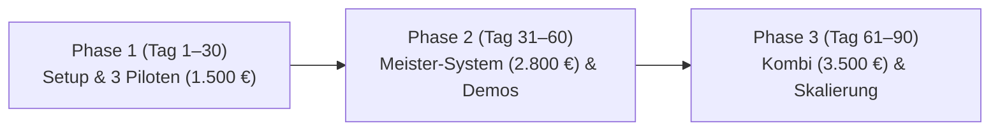

# SparrenWeb – Operativer 30 / 60 / 90-Tage-Plan
**Stand:** 06. November 2026  
**Dokumenttyp:** Interner Ausführungs- und Meilensteinplan

---

## Übersicht & strategische Phasen

---

## Phase 1: Tag 1 bis 30 – Setup, Launch-Freigaben & die 3 Pilotprojekte

### Woche 1 (Tag 1–7): Rechtlicher & Technischer Vorlauf
- [ ] **Gewerbeanmeldung:** Anmeldung Einzelunternehmen / GbR beim Gewerbeamt Bielefeld einreichen.
- [ ] **Finanzamt:** Fragebogen zur steuerlichen Erfassung ausfüllen, Antrag auf Ist-Versteuerung & USt-ID stellen.
- [ ] **Geschäftskonto & Buchhaltung:** Geschäftskonto (z. B. Finom/Qonto/Commerzbank) und Buchhaltungstool (z. B. Lexoffice/Sevdrive) anbinden.
- [ ] **Rechtliche Seiten im Web freischalten:** `impressum.html` und `datenschutz.html` mit den realen Daten finalisieren (Launch-Blocker auflösen).
- [ ] **Mail-Setup:** Professionelles E-Mail-Postfach einrichten (DKIM, SPF, DMARC auf `@sparrenweb.de`).

### Woche 2 (Tag 8–14): Akquise-Kampagne für die 3 OWL-Piloten
- [ ] **Leadliste aufbauen:** 50 handverlesene Meisterbetriebe (Dach, SHK, Elektro) in Bielefeld, Herford, Gütersloh recherchieren (`04_lead_und_kpi_vorlagen.csv`).
- [ ] **Postalischer Versand:** 25 hochwertige, personalisierte Anschreiben (Vorlage 1) versenden.
- [ ] **Erste Klick-Demos vorbereiten:** Vorab-Layouts für spezifische Gewerke zur Präsentation bereitstellen.

### Woche 3 (Tag 15–21): Telefonisches Nachfassen & Ersttermine
- [ ] **Nachfass-Telefonate:** Systematisches Nachfassen der Briefe gemäß 20-Minuten-Leitfaden.
- [ ] **Präsentationstermine:** Mindestens 4 bis 6 Bildschirmpraesentationen durchführen.
- [ ] **Abschluss der ersten 1–2 Pilotverträge:** 1.500 € netto (50 % Anzahlung = 750 € fällig bei Beauftragung).
- [ ] **REVIEW TAG 21:**
  - *Soll:* Mindestens 1 fester Pilotvertrag unterzeichnet, mind. 3 Klick-Demos präsentiert.
  - *Abweichungsanalyse:* Falls 0 Abschlüsse: Nutzenargumentation (Zeitersparnis vs. Kosten) schärfen, telefonischen Einstieg anpassen.

### Woche 4 (Tag 22–30): Umsetzung Pilot 1 & Abschluss Pilot 2 und 3
- [ ] **Umsetzung Pilot 1:** 90-Minuten-Onboarding, Content-Erstellung, Vorabfilter anpassen, Kundenfeedback einholen.
- [ ] **Akquise-Abschluss:** Pilotplatz 2 und 3 verbindlich besetzen.
- [ ] **Go-Live Pilot 1:** Abnahme durch Kunden, Restzahlung (750 €) fakturieren.

---

## Phase 2: Tag 31 bis 60 – Reguläres Meister-System (2.800 €) & Referenzvermarktung

### Woche 5 (Tag 31–37): Übergabe aller Piloten & Referenz-Freigabe
- [ ] **Go-Live Pilot 2 & 3:** Vollständige Fertigstellung innerhalb der 14-Tage-Frist.
- [ ] **Referenz-Freigabe einholen:** Unterzeichnung der Checkliste (`08_referenz_freigabe_checkliste.md`) für Bild- und Zitatnutzung.
- [ ] **Pilot-Badge auf Website deaktivieren:** Sobald 3 Piloten belegt sind, Angebot A auf der Website als „Aktuell voll belegt“ kennzeichnen oder entfernen; Standardangebot B (2.800 €) wird Hauptprodukt.

### Woche 6 (Tag 38–45): Fallstudien auf `referenzen.html` integrieren
- [ ] **Erste echte Fallstudie veröffentlichen:** Screenshot des echten Projekts, Zitat des Meisters, Kennzahlen (z. B. bearbeitete Anfragen, Zeitersparnis).
- [ ] **REVIEW TAG 45:**
  - *Soll:* Alle 3 Pilotprojekte bezahlt (4.500 € Gesamtumsatz), mind. 2 Betreuungsverträge (Angebot C, je 250 €/Mo) abgeschlossen.
  - *Liquiditätsprüfung:* Reichen Rücklagen für Steuern (USt & ESt-Rücklage 35 %)?

### Woche 7 & 8 (Tag 46–60): Reguläre Akquise Meister-System (2.800 €)
- [ ] **Neue Versandwelle:** 30 Briefe an Meisterbetriebe mit Verweis auf die fertige lokale Referenz.
- [ ] **Ziel:** Abschluss von 1–2 regulären Projekten zu 2.800 € netto.
- [ ] **REVIEW TAG 60:**
  - *Soll:* Monatsumsatz Monat 2 > 3.000 €, kumulierter Cashflow positiv.
  - *Belastungsprüfung:* Zeitaufwand pro Projekt validieren (Ziel: <= 24h pro Meister-System).

---

## Phase 3: Tag 61 bis 90 – Kombi-Angebote (3.500 €) & Skalierungsvorbereitung

### Woche 9 & 10 (Tag 61–75): Recruiting-Modul aktiv platzieren
- [ ] **Up-Sell an Bestandskunden:** Angebot D (Recruiting-Modul, 1.200 €) den bisherigen Kunden als Ergänzung zur Mitarbeitergewinnung vorstellen.
- [ ] **Neukunden-Pitch mit Kombi-Fokus:** Angebot E (3.500 € Komplett-Kombi) als wirtschaftlichstes Gesamtsystem positionieren.
- [ ] **Wiederkehrende Einnahmen (MRR):** Ziel von 1.000 € monatlich wiederkehrendem Betreuungsumsatz erreichen.

### Woche 11 & 12 (Tag 76–90): Skalierung & Partner-Integration
- [ ] **Partner-Netzwerk antesten:** Freie Texter oder Fotografen für Handwerkerprojekte briefen (`06_skalierungsregeln_und_partnerintegration.md`).
- [ ] **REVIEW TAG 90 (Große Quartalsprüfung):**
  - *KPI-Check:* Wurden in 90 Tagen mind. 5–7 Betriebe gewonnen?
  - *Umsatz:* Zielkorridor 12.000 € – 18.000 € Gesamtumsatz im ersten Quartal erreicht?
  - *Arbeitszeit:* Bleibt der zeitliche Aufwand pro Projekt stabil unter 25 Stunden?
  - *Nächster Schritt:* Übergang in kontinuierlichen Monatsrhythmus (2 Meister-Systeme + 1 Kombi pro Monat).
